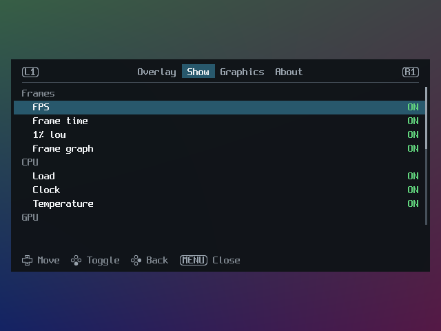
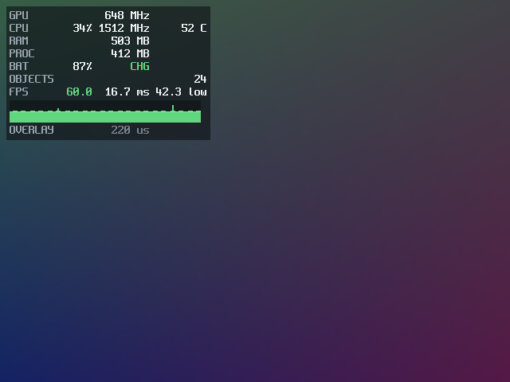

# sbc-port-overlay

Settings menu and performance overlay for Linux ports on ARM handhelds
(muOS, KNULLI, ROCKNIX, Spruce, AmberELEC).

<p align="center"></p>

<p align="center">


</p>

- Tap Menu to open it. Menu+button firmware hotkeys keep working.
- The menu has tabs: Overlay, Show, one per port page and About. L1 and R1
  switch tabs, and the menu saves when it closes.
- Every value is its own toggle: FPS, frame time, 1% low, frame graph, CPU and
  GPU load, clocks, temperature, RAM, the game's memory, battery and charging,
  and each port counter and indicator. Presets (Off, FPS, Basic, Graph, Full)
  set the toggles; the preset reads Custom when they match none.
- Rows and colours follow MangoHud: FPS is red below 30, yellow below 60 and
  green from there, and CPU and GPU load turn yellow at 60% and red at 90%. A
  colour change shows after it has held for a second.
- Ports can add their own settings pages and counters. Settings are saved per
  port.
- Each frame is a single draw call, with no allocations. Stats are read once a
  second on a background thread.

## Usage

```c
static void *resolve(const char *name, void *user) {
    return SDL_GL_GetProcAddress(name);
}

spo_config config = {0};
config.struct_size = sizeof(config);
config.abi_version = SPO_ABI_VERSION;
config.get_proc_address = resolve;
config.config_path = "conf/overlay.ini";
config.port_name = "My Port";
config.port_version = "1.0";
spo_init(&config);

while (SDL_PollEvent(&event)) {
    if (!spo_handle_sdl_event(&event))
        handle_game_event(&event);
}
if (!spo_input_captured())
    poll_game_controller();

render_game();
spo_frame(width, height);
SDL_GL_SwapWindow(window);

/* on exit */
spo_config_save();
spo_shutdown();
```

See [docs/api.md](docs/api.md) for settings pages, counters, input without
SDL and threading.

## Build

```cmake
set(SPO_BUILD_SDL2 ON)
add_subdirectory(third_party/sbc-port-overlay)
target_link_libraries(my_port PRIVATE spo::static spo::sdl2)
```

Tests: `cmake -S . -B build && cmake --build build && ctest --test-dir build`.

To build ports for these devices with an AI coding agent, see the
[handheld development skill](https://github.com/Producdevity/sbc-handheld-development-skill).

## License

MIT. The Spleen font is BSD-2-Clause.
